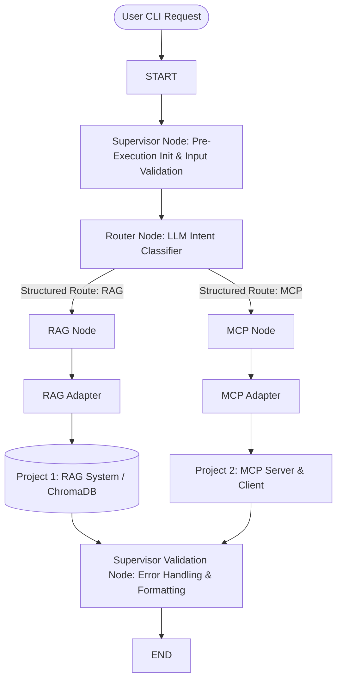

# 🤖 Project 3: Enterprise Agentic AI Assistant

A production-grade, multi-subsystem **Agentic AI Assistant** built with **LangGraph**, **LangChain**, **ChromaDB**, **Model Context Protocol (MCP)**, and **Google Gemini**. 

Project 3 integrates two existing independent production applications:
- **Project 1 (`project-1-rag`)**: PDF RAG Application (Vector Search & Anti-Hallucination Q&A)
- **Project 2 (`project-2-mcp`)**: Model Context Protocol System (Math, Time, UUID, File Tools)

Neither Project 1 nor Project 2 was modified or rewritten. They are integrated using non-invasive **Adapters** orchestrated by a **LangGraph StateGraph** and a **Supervisor-Router Agent Architecture**.

---

## 🏗️ System Architecture



---

## 📁 Project Structure

```text
project-3-agent/
│
├── .env.example                # Template for Gemini/OpenAI API configuration
├── requirements.txt            # Dependency specifications
├── config.py                   # Centralized configuration & backward compatibility
├── state.py                    # Strongly typed LangGraph State Schema (AgenticState)
├── prompts.py                  # Production System Prompts for Router & Supervisor
├── app.py                      # Interactive CLI REPL with conversation memory
├── README.md                   # Production system documentation
│
├── adapters/
│   ├── __init__.py
│   ├── rag_adapter.py          # Non-invasive Adapter for Project 1 (RAG)
│   └── mcp_adapter.py          # Non-invasive Adapter for Project 2 (MCP)
│
├── agents/
│   ├── __init__.py
│   ├── router.py               # Structured LLM Intent Router Agent (Pydantic output)
│   └── supervisor.py           # Supervisor Agent for validation & response formatting
│
├── nodes/
│   ├── __init__.py
│   ├── supervisor_node.py      # Entry (supervisor_init) and Exit (supervisor_validation) nodes
│   ├── router_node.py          # Router execution node handler
│   ├── rag_node.py             # RAG execution node handler
│   └── mcp_node.py             # MCP tool execution node handler
│
├── graph/
│   ├── __init__.py
│   ├── builder.py              # LangGraph StateGraph builder and compiler
│   └── edges.py                # Conditional routing logic functions
│
└── utils/
    ├── __init__.py
    ├── logger.py               # Structured colorized logger writing to sys.stderr
    └── exceptions.py           # Custom exception hierarchy
```

---

## 🚀 Setup & Installation

### 1. Prerequisites
- Python 3.12 or higher
- A Google Gemini API Key (`GEMINI_API_KEY`)

### 2. Environment Configuration
Copy `.env.example` to `.env` in the `project-3-agent` directory:

```bash
cp .env.example .env
```

Ensure `.env` contains your Gemini API key:
```env
GEMINI_API_KEY=your_actual_gemini_api_key
LLM_MODEL_NAME=gemini-2.5-flash
EMBEDDING_MODEL_NAME=gemini-embedding-001
PROJECT_1_DIR=../project-1-rag
PROJECT_2_DIR=../project-2-mcp
LOG_LEVEL=INFO
```

---

## 💻 Running the Application

To launch the interactive multi-turn CLI REPL:

```bash
python app.py
```

### Interactive CLI Commands
- `help` - Display available commands and guidance.
- `health` - View live status of RAG vector store, MCP tools, loaded models, and conversation memory length.
- `history` - View the multi-turn conversation transcript.
- `clear` - Clear the terminal screen and reset conversation history.
- `exit` or `quit` - Gracefully close MCP client sessions and shut down the application.

---

## 🧠 How Subsystems Work

### 1. Router Agent & Semantic Intent Classification
Every request enters the **Router Agent**, which uses Gemini LLM structured outputs to generate a typed `RouterDecision` Pydantic model (`route`, `confidence`, `reasoning`).
- Queries about technical documents, PDFs, or document content are routed to `RAG`.
- Queries requiring calculation, time/date, UUIDs, or reading file paths are routed to `MCP`.
- No keyword matching or fragile `if/else` rules are used.

### 2. RAG Subsystem Integration (`RAGAdapter`)
When routed to `RAG`:
- `rag_node` delegates to `RAGAdapter.query()`.
- `RAGAdapter` dynamically loads Project 1 (`project-1-rag`) and queries the persisted ChromaDB vector database.
- Retrieved document context and citations are attached to `AgenticState`.

### 3. MCP Subsystem Integration (`MCPAdapter`)
When routed to `MCP`:
- `mcp_node` delegates to `MCPAdapter.execute()`.
- `MCPAdapter` dynamically spawns Project 2's MCP Server (`server.py`) over stdio JSON-RPC transport and executes the tool workflow.
- Tool call execution metadata is attached to `AgenticState`.

### 4. Supervisor Node & Output Normalization
Before completion, execution enters `supervisor_validation_node`:
- Output is formatted cleanly into human-readable text.
- Citations are formatted cleanly into a "Sources & Citations" section for RAG queries.
- Tool execution notes are appended for MCP queries.
- Total execution duration metrics are recorded.

---

## 🔮 Future Expansion (Adding New Subsystems)

The architecture uses a **Pluggable Node Registry** pattern. To add a new sub-agent (e.g. `WebSearchAgent` or `SQLAgent`):
1. Create `adapters/web_search_adapter.py`.
2. Add `"WEB_SEARCH"` option to `RouterDecision` in `agents/router.py`.
3. Create `nodes/web_search_node.py`.
4. Register `web_search_node` in `graph/builder.py` and update `graph/edges.py`.
5. Existing RAG, MCP, and Supervisor nodes remain completely untouched!

---

## 🛠️ Troubleshooting

- **`429 RESOURCE_EXHAUSTED`**: You have hit the Google Gemini Free Tier rate limit (20 requests per day/minute). Wait 30–60 seconds before retrying.
- **`Vector Store missing`**: Run `python project-1-rag/app.py ingest` to populate ChromaDB with PDFs before querying RAG.
